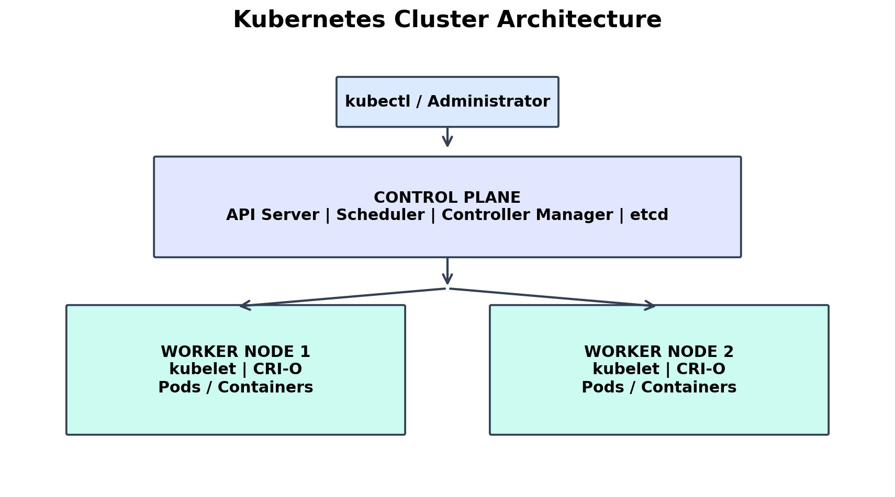
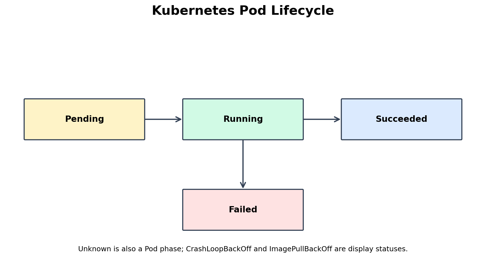
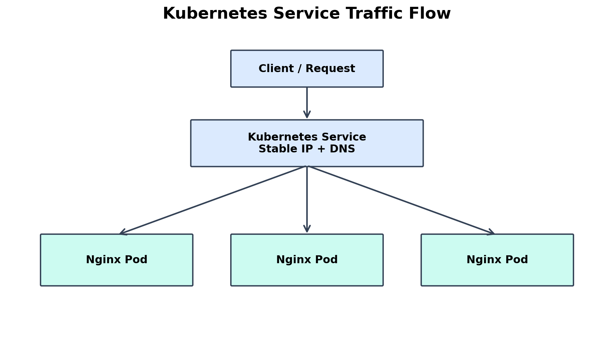
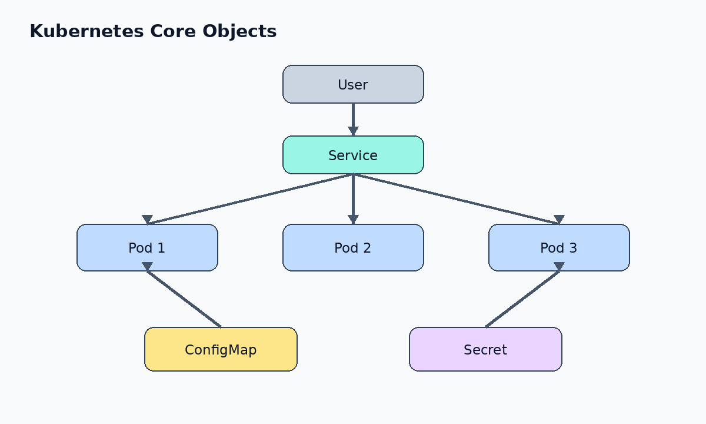
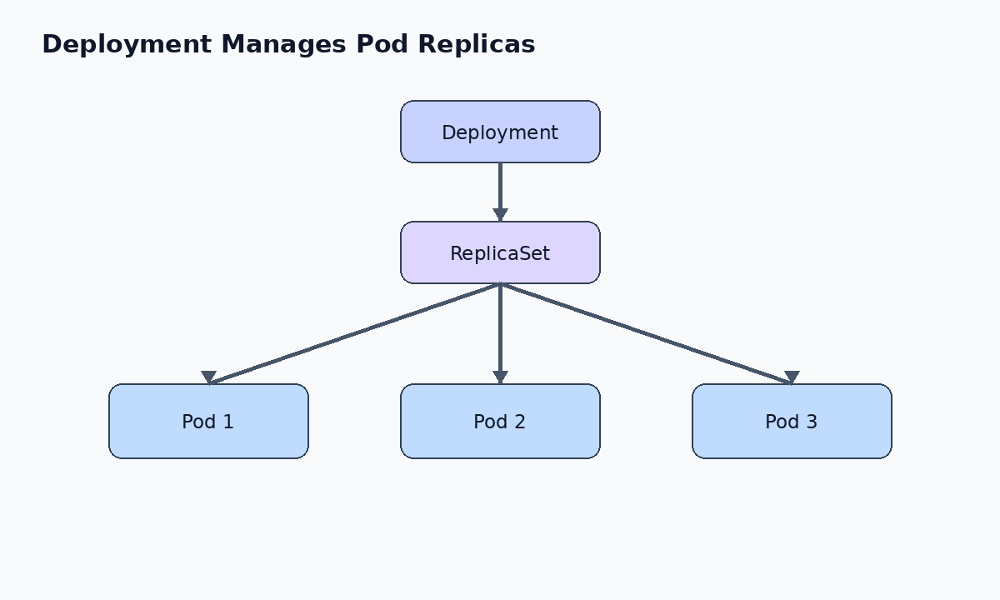
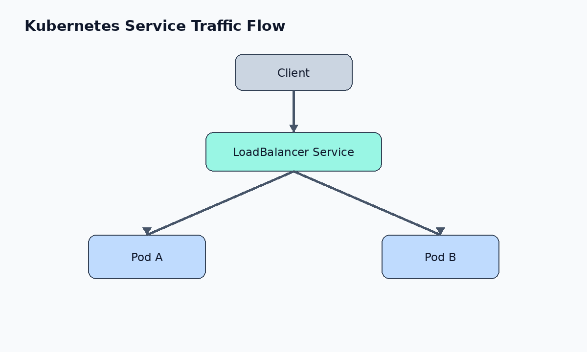
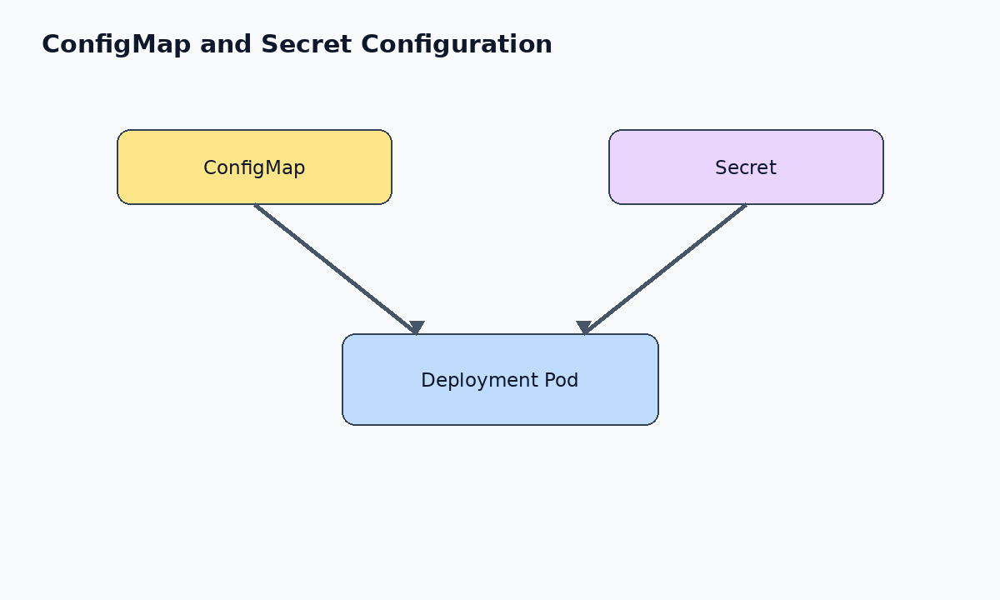

# Kubernetes (K8s) — Hands-on YAML Labs

Practical Kubernetes examples for learning Pods, workload controllers, networking, application configuration, storage, and basic Amazon EKS cluster creation. These notes map to the **actual files in this repository**.



## Prerequisites

- A running Kubernetes cluster (Minikube, kind, Amazon EKS, AKS, or a kubeadm cluster)
- `kubectl` installed and configured to access that cluster
- Optional: `eksctl`, AWS CLI, AWS credentials and suitable IAM permissions for the Amazon EKS example
- A default StorageClass or suitable PersistentVolumes for the StatefulSet's claims

Verify your context before making changes:

```bash
kubectl config current-context
kubectl cluster-info
kubectl get nodes
kubectl get storageclass
```

> **Warning:** The EKS creation script provisions billable AWS resources. The Service of type LoadBalancer may also provision a billable cloud load balancer.

## Repository files

| File | Resource / purpose | Details |
| --- | --- | --- |
| [`pod.yml`](pod.yml) | Pod `mypod` | NGINX on port 80; imports `myapp` ConfigMap and `mysecret` Secret |
| [`configmap.yml`](configmap.yml) | ConfigMap `myapp` | `environment=production` |
| [`secrets.yml`](secrets.yml) | Secret `mysecret` | `stringData` keys `dbadmin`, `password` |
| [`replicaset.yml`](replicaset.yml) | ReplicaSet `myreplicaset` | Keeps 3 NGINX Pods with label `app: myapp` |
| [`daemonset.yml`](daemonset.yml) | DaemonSet `myapp` | NGINX Pod on each eligible node, with 128Mi/500m limits |
| [`statefulset.yml`](statefulset.yml) | StatefulSet `mystatefulset` | 2 replicas; `www` PVC of 1Gi per replica |
| [`services.yml`](services.yml) | LoadBalancer Service `myapp` | Port 80 to 80; targets Pods with `app: myapp` |
| [`deployment.yml`](deployment.yml) | **Currently a Pod, not a Deployment** | Defines `mypod`; duplicate of a basic Pod manifest |
| [`create-cluster.sh`](create-cluster.sh) | Amazon EKS provisioning | `eksctl` managed node group in `us-east-1` |
| [`pod-service.md`](pod-service.md) | Extended lab guide | kubeadm, CRI-O, Pods and Services |
| [`DNS.md`](DNS.md) | Extended learning guide | Deployments, networking, Ingress and DNS |

## 1. Clone and inspect

```bash
git clone https://github.com/atulkamble/k8s.git
cd k8s
ls
kubectl get pods,services,deployments,replicasets,daemonsets,statefulsets
```

## 2. ConfigMap + Secret + Pod

The Pod explicitly references both configuration resources, so **create them first**:

```bash
kubectl apply -f configmap.yml
kubectl apply -f secrets.yml
kubectl apply -f pod.yml

kubectl get configmap myapp
kubectl get secret mysecret
kubectl get pod mypod -o wide
kubectl describe pod mypod
kubectl exec mypod -- printenv environment
kubectl exec mypod -- printenv dbadmin
```

`configmap.yml` defines:

```yaml
apiVersion: v1
kind: ConfigMap
metadata:
  name: myapp
data:
  environment: "production"
```

`secrets.yml` uses `stringData`, which accepts plain text and is converted into Secret `data` by the API server:

```yaml
apiVersion: v1
kind: Secret
metadata:
  name: mysecret
type: Opaque
stringData:
  dbadmin: atul
  password: Password123
```

> **Security:** The checked-in Secret is a **demo only** and contains example credentials in plaintext. Do not reuse those credentials or commit real passwords. Kubernetes Secrets are not automatically encrypted at rest in all clusters. Use secret management and RBAC appropriate for production.

To encode a sample value for the alternative `data` format:

```bash
echo -n 'atul' | base64
echo -n 'Password123' | base64
```

Base64 is **encoding, not encryption**. The plain strings `atul` and `Password123` cannot go directly under `data`; keep them under `stringData`.

**Changing Pod spec:** If `mypod` already exists, adding container ports or `envFrom` may fail because most Pod spec fields cannot be changed in place. For this disposable lab:

```bash
kubectl delete pod mypod
kubectl apply -f pod.yml
```

Do not delete a production Pod without understanding its controller and impact.



## 3. ReplicaSet

```bash
kubectl apply -f replicaset.yml
kubectl get replicaset myreplicaset
kubectl get pods -l app=myapp -o wide
kubectl describe replicaset myreplicaset
```

The ReplicaSet requests **3** NGINX replicas. Its Pod template carries the label `app: myapp`.

## 4. DaemonSet

```bash
kubectl apply -f daemonset.yml
kubectl get daemonset myapp
kubectl get pods -l app=myapp -o wide
```

A DaemonSet normally schedules one Pod on every eligible node. This example has resource limits of `128Mi` memory and `500m` CPU. DaemonSets use **`apiVersion: apps/v1`**, not `v1`.

## 5. Service and networking

```bash
kubectl apply -f services.yml
kubectl get service myapp
kubectl describe service myapp
kubectl get endpoints myapp
kubectl get pods -l app=myapp --show-labels
```

The Service is `type: LoadBalancer`, exposes port **80**, targets port **80**, and selects `app: myapp`. The standalone Pod in `pod.yml` does **not** have that label; it is **not selected** by this Service. The ReplicaSet, DaemonSet and StatefulSet templates **do** use `app: myapp`, so they can all be selected when run together. For clearer labs, create controllers separately or use distinct application labels/selectors.

On Minikube or a cluster without a load balancer implementation, `EXTERNAL-IP` may remain `<pending>`. For local access, use:

```bash
kubectl port-forward service/myapp 8080:80
# Open http://localhost:8080 in another terminal/browser
```

Port-forwarding requires the Service to have ready backing Pods.



## 6. StatefulSet and persistent storage

```bash
kubectl apply -f statefulset.yml
kubectl get statefulset mystatefulset
kubectl get pods -l app=myapp
kubectl get pvc
kubectl describe statefulset mystatefulset
```

This manifest requests **2 replicas**, each with its own `www` volume claim requesting **1Gi**, mounted at `/usr/share/nginx/html`.

**Important distinction:** `statefulset.yml` sets `serviceName: myapp`, but `services.yml` defines a **LoadBalancer** Service, not a headless governing Service. For stable per-Pod StatefulSet DNS names, create a separate headless Service (`clusterIP: None`) with the name referenced by `serviceName` and a matching selector. Check your StorageClass if PVCs stay Pending.

## 7. Deployment file caveat

The repository's `deployment.yml` currently contains `apiVersion: v1` and `kind: Pod` with name `mypod`. Applying it does **not** create a Kubernetes Deployment and may conflict with `pod.yml`. To experiment with Deployments, use a separate manifest with `apiVersion: apps/v1`, `kind: Deployment`, and matching `spec.selector.matchLabels` / `spec.template.metadata.labels`.

## 8. Optional Amazon EKS cluster lab

[`create-cluster.sh`](create-cluster.sh) runs:

```bash
eksctl create cluster \
  --name mycluster \
  --region us-east-1 \
  --nodegroup-name mynodes \
  --node-type t3.medium \
  --nodes 2 \
  --nodes-min 2 \
  --nodes-max 2 \
  --managed
```

Requires configured AWS credentials, `eksctl`, sufficient quotas/permissions and an appropriate region. Confirm the active cluster with `kubectl config current-context` after creation.

To remove **this example** cluster when finished (destructive):

```bash
eksctl delete cluster --name mycluster --region us-east-1
```

## 9. Common troubleshooting

| Problem | Cause / fix |
| --- | --- |
| `no matches for kind "ConfigMap" in version "apps/v1"` | ConfigMap API version is `v1` |
| `no matches for kind "DaemonSet" in version "v1"` | DaemonSet API version is `apps/v1` |
| `illegal base64 data` | Plain text was placed under Secret `data`; use `stringData` or properly Base64-encode `data` |
| Pod update forbidden | Pod spec has mostly immutable fields; recreate the disposable Pod or use a controller |
| Service endpoints missing | Verify Pod readiness and matching selector labels with `kubectl get pods --show-labels` |
| Service external IP pending | Local cluster may not have a load balancer controller; use `kubectl port-forward` |
| StatefulSet claims Pending | Check StorageClass, provisioning and capacity using `kubectl describe pvc` |
| No Deployment appears | `deployment.yml` is currently a Pod manifest |

Helpful commands:

```bash
kubectl get all
kubectl get pods -o wide
kubectl describe pod mypod
kubectl logs mypod
kubectl get events --sort-by=.metadata.creationTimestamp
kubectl get configmaps,secrets,pvc
```

## 10. Cleanup

Run only against the intended lab cluster and namespace:

```bash
kubectl delete -f pod.yml --ignore-not-found
kubectl delete -f replicaset.yml --ignore-not-found
kubectl delete -f daemonset.yml --ignore-not-found
kubectl delete -f statefulset.yml --ignore-not-found
kubectl delete -f services.yml --ignore-not-found
kubectl delete -f configmap.yml --ignore-not-found
kubectl delete -f secrets.yml --ignore-not-found
```

StatefulSet PVCs are commonly retained after deleting the StatefulSet. Review `kubectl get pvc` and delete only disposable claims you no longer need.

## Additional learning diagrams









## References

- [Kubernetes documentation](https://kubernetes.io/docs/)
- [kubectl cheat sheet](https://kubernetes.io/docs/reference/kubectl/quick-reference/)
- [Amazon eksctl documentation](https://eksctl.io/)
- [Detailed Pods and Services lab](pod-service.md)
- [Ingress, Deployments and DNS notes](DNS.md)

---

Maintained by [Atul Kamble](https://github.com/atulkamble) for hands-on Kubernetes practice and training.
